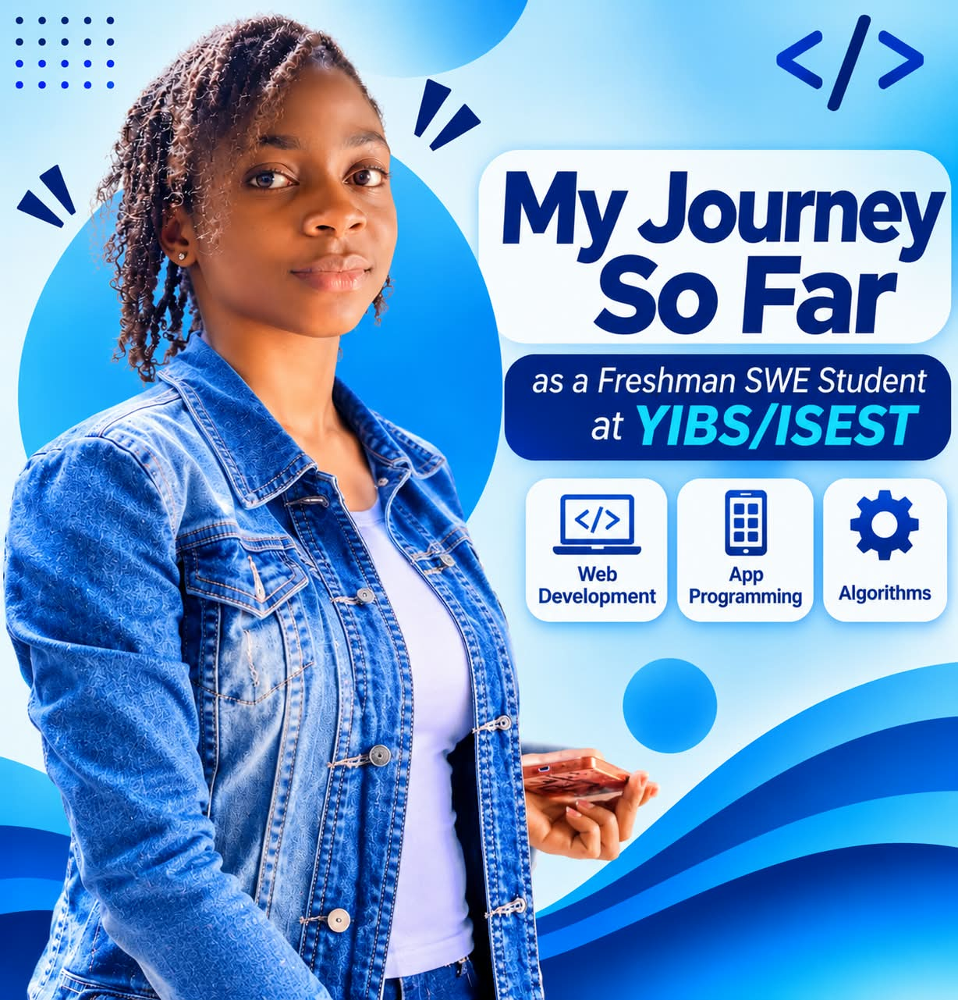

# My-Journey-So-Far-as-a-Freshman-Software-Engineer-at-YIBS/ISEST

Every new journey comes with its own experiences, challenges, and lessons. My journey as a freshman Software Engineering (SWE) student at YIBS/ISEST has been an interesting experience so far, filled with moments that have helped me grow both academically and personal

When I first started school, things were not as easy as I had imagined. Everything was new to me. I was unfamiliar with the faces around me, the school environment, and even my teachers.

At first, adapting to this new atmosphere was quite challenging. However, as time went by, I gradually became comfortable with my surroundings, got familiar with the people around me, and made an effort to understand my teachers and their different teaching methods.

One thing that initially frustrated me was the large number of assignments we were given. Sometimes, it felt overwhelming, and I wondered why we had so much work to do.

However, with time, I began to understand that these assignments were not meant to punish us but to help us improve our knowledge, develop our skills, and become independent learners

Another exciting part of my journey has been discovering the practical side of Software Engineering.

So far, I have started:
Learning HTML,Exploring different,programming applications and understanding the basics of algorithm

Although I am still a beginner, these experiences have increased my curiosity and interest in technology.

As I continue my journey, I hope to:
Improve my programming skills.
Learn more programming languages.
Build my own websites and applications.
Develop creative solutions to real-world problems.

I know there is still a lot to learn. There will be challenges, difficult concepts, and moments when I may feel overwhelmed. But I am determined to remain focused, keep practising, and make the most of every opportunity.

**Every challenge is a lesson, every assignment is an opportunity, and every line of code brings me one step closer to my dream.**

I am proud of how far I have come, but even more excited about how far I can go.

**This is just the beginning of my story. The journey continues! **

---
